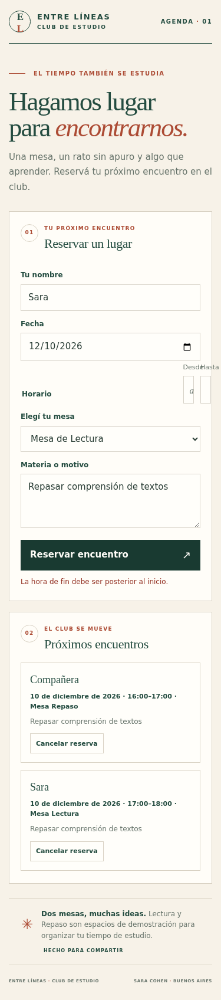

# Agenda de encuentros

## 🧩 Datos generales

| Campo | Detalle |
| --- | --- |
| Integrante 1 | Sara Cohen |
| Integrante 2 | No corresponde: trabajo individual |
| Modelos de IA utilizados | ChatGPT; GPT-6 Luna (implementación y revisión) |
| Tecnologías del proyecto | HTML5, CSS3, JavaScript, Markdown, Visual Studio Code y GitHub |
| Link del repositorio | https://github.com/2023saracohen-yeshurun/turnos-club-estudio |

---

## 📄 Sketch

Boceto guardado antes de la implementación. La distribución conserva el encabezado superior, formulario a la izquierda, próximos encuentros arriba a la derecha, comprobante debajo y nota informativa al pie.

## 💬 Prompts utilizados

### Encargo inicial — fragmento funcional literal

> Formulario nombre fecha inicio fin recurso motivo, mesas Lectura y Repaso (demostración). Reservas localStorage, orden cronológico, cancelación, comprobante imprimible. Solapamiento sameDate && sameResource && newStart<existingEnd && newEnd>existingStart. Convertir horas a minutos, fin>inicio, same-day, campos completos. Consecutivos y distintos recursos permitidos. Al rechazo ocultar comprobante anterior para no confundir; cancelar comprobante si turno fue cancelado. Tests intervalos idéntico/parcial/contenido/contiene/adyacentes/otra fecha/recurso y entradas inválidas. Manejo storage corrupto y fallos, texto seguro. Estilos print solo comprobante.

### Prompt de ajuste

> Revisión: el boceto define IDs nombre, fecha, inicio, fin, recurso, motivo. Alineá solo IDs/for/selectores con esos nombres (names internos pueden seguir inglés). Revisá fecha pasada: pusiste min=today pero novalidate; no impongas restricción solo visual sin validación. Elegí permitir fechas para ejercicios eliminando min o valida pasado y documenta. Terminá y reportá; coordinador hace browser QA.

## Evidencias

[Comprobante de ejemplo en PDF](evidencias/comprobante-ejemplo.pdf)

## Herramientas utilizadas

HTML, CSS, JavaScript, Visual Studio Code, GitHub, Chrome y archivos Markdown. Asistencia de IA: GPT-6 Luna en las tareas delegadas de implementación y revisión.

[Repositorio](https://github.com/2023saracohen-yeshurun/turnos-club-estudio)

[Sitio del proyecto](https://2023saracohen-yeshurun.github.io/turnos-club-estudio/)

## Estado del proyecto

- [x] Sketch previo al código.
- [x] Prompts y decisiones registrados.
- [x] Pruebas de lógica y navegador realizadas.
- [x] Archivos publicados en el repositorio público.

## Ajuste visual de los horarios

**Prompt de corrección:**

> Los campos Desde y Hasta quedan de 18 px de ancho en escritorio. Separá el título Horario de la fila de controles, mantené las etiquetas asociadas y asegurá un ancho legible también a 320 px. Verificá que cada campo tenga al menos 100 px.

La prueba de ancho reprodujo el problema. Se reemplazó la distribución del grupo por una fila interior de dos columnas, con el título por encima.
