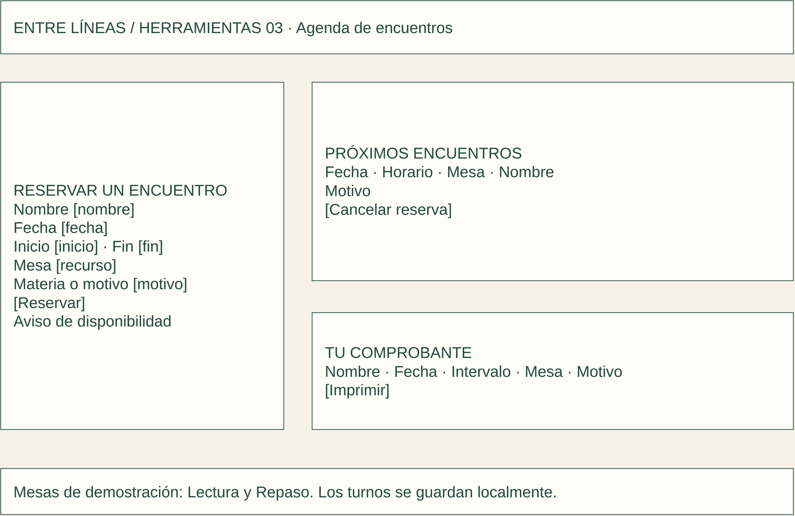
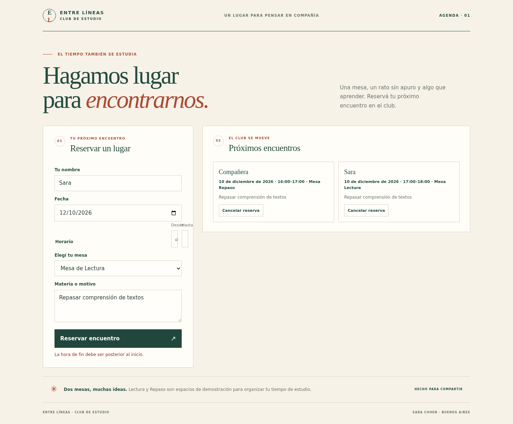
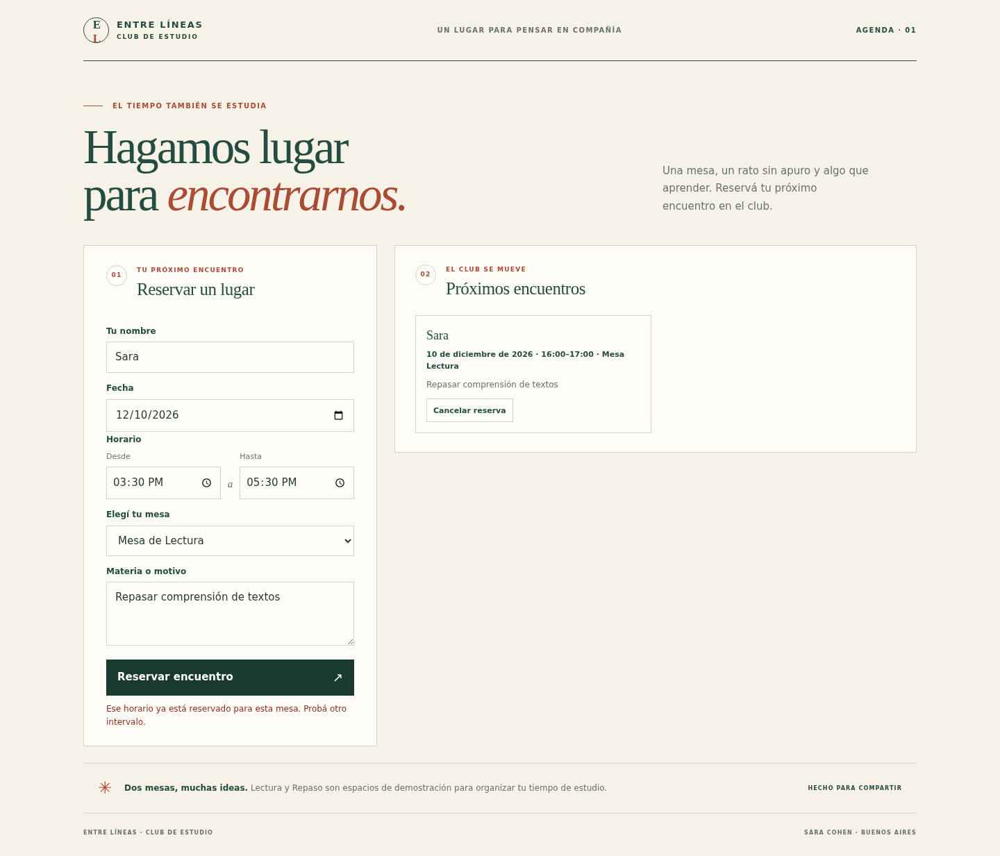
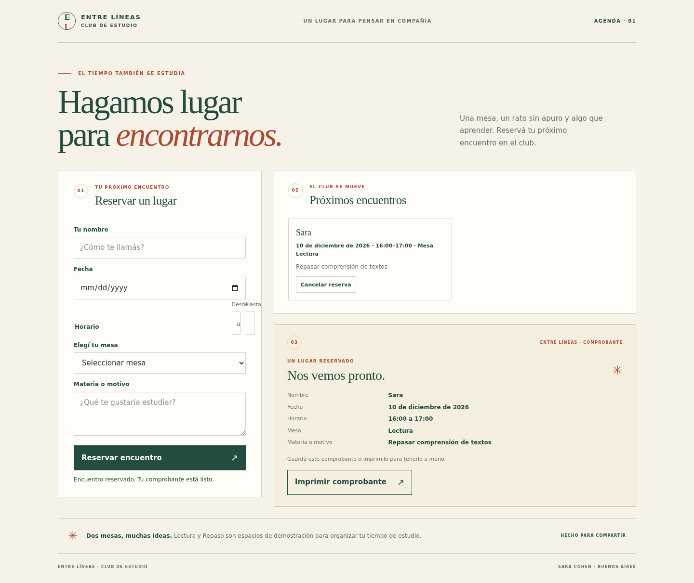

# Agenda de encuentros

## 🧩 Datos generales

Estudiante: Sara Cohen. Club Entre Líneas.  
Repositorio: `2023saracohen-yeshurun`.  
Proyecto: agenda local de mesas de estudio.

## 📄 Sketch



Boceto guardado antes de la implementación. La distribución conserva el encabezado superior, formulario a la izquierda, próximos encuentros arriba a la derecha, comprobante debajo y nota informativa al pie.

## Planeamiento

Diseño editorial: papel crema `#f7f2e8`, verde pino `#244c40` y terracota `#ac4b34`. Títulos Georgia y tipografía sans serif del sistema. Diseño adaptable con foco visible, etiquetas asociadas, mensajes accesibles y respeto por la preferencia de movimiento reducido.

Los campos conservan los identificadores del boceto (`nombre`, `fecha`, `inicio`, `fin`, `recurso`, `motivo`). Se permiten fechas pasadas para facilitar ejercicios; no se establece una fecha mínima visual ni se rechaza una fecha pasada en la validación.

La página está hecha con HTML, CSS y JavaScript sin frameworks. Las dos mesas de demostración son Lectura y Repaso. Los turnos se guardan en `localStorage` en el dispositivo y navegador actuales; la lista se ordena por fecha y hora. Se permiten intervalos consecutivos y reservas de recursos o fechas diferentes. No existe sincronización entre dispositivos.

El comprobante aparece tras una reserva válida y puede imprimirse. Al cancelar una reserva, se elimina de la agenda; si correspondía al comprobante visible, este se oculta y deja de estar vigente. Un intento rechazado también oculta el comprobante anterior. Los datos ingresados se renderizan como texto, sin interpretar HTML.

## 💬 Prompts utilizados

### Encargo inicial — fragmento funcional literal

> Formulario nombre fecha inicio fin recurso motivo, mesas Lectura y Repaso (demostración). Reservas localStorage, orden cronológico, cancelación, comprobante imprimible. Solapamiento sameDate && sameResource && newStart<existingEnd && newEnd>existingStart. Convertir horas a minutos, fin>inicio, same-day, campos completos. Consecutivos y distintos recursos permitidos. Al rechazo ocultar comprobante anterior para no confundir; cancelar comprobante si turno fue cancelado. Tests intervalos idéntico/parcial/contenido/contiene/adyacentes/otra fecha/recurso y entradas inválidas. Manejo storage corrupto y fallos, texto seguro. Estilos print solo comprobante.

### Prompt de ajuste

> Revisión: el boceto define IDs nombre, fecha, inicio, fin, recurso, motivo. Alineá solo IDs/for/selectores con esos nombres (names internos pueden seguir inglés). Revisá fecha pasada: pusiste min=today pero novalidate; no impongas restricción solo visual sin validación. Elegí permitir fechas para ejercicios eliminando min o valida pasado y documenta. Terminá y reportá; coordinador hace browser QA.

## Decisiones de implementación

- Se mantuvo la composición dibujada, con el formulario en la primera columna y agenda/comprobante en la segunda; en pantallas angostas se apilan.
- La lógica de validación, conversión horaria, solapamiento, orden y acceso al almacenamiento se exporta para Node y solo conecta con el DOM cuando `document` existe.
- El solapamiento usa `sameDate && sameResource && newStart < existingEnd && newEnd > existingStart`, con horas convertidas a minutos. Por eso un turno que empieza justo al terminar otro queda permitido.
- El almacenamiento inválido o inaccesible no interrumpe la carga. Los registros recuperados se validan antes de mostrarse. Un error de guardado informa al usuario.
- Lista, formulario y comprobante usan nodos y `textContent` para presentar la información ingresada con seguridad.
- La hoja de impresión oculta el resto de la interfaz y deja visible únicamente el comprobante.

## Pruebas ejecutadas

Entorno verificado: Node.js `v22.23.3`, ejecutable `node`. Sin dependencias externas.

Comando ejecutado:

```sh
node tests/appointments.test.js
```

Resultado observado: 8 pruebas aprobadas, 0 fallidas. Se verificaron conversión horaria, intervalos idénticos, parciales, contenidos y contenedores, adyacencia, fecha y recurso distintos, validación de campos/fechas/horas, orden sin mutación y recuperación/guardado con datos corruptos o almacenamiento fallido.

Se probaron en Chrome reservas válidas, coincidencia exacta, superposición parcial, contención, turnos consecutivos y otros recursos. También cancelación, persistencia, comprobante, impresión y diseño a 320, 375, 768 y 1280 px.


## 🔄 Diferencias entre versiones

| Versión | Cambio | Motivo |
| --- | --- | --- |
| 1 | Formulario, agenda, comprobante y lógica de choques. | Resolver las reservas locales del club. |
| 2 | Identificadores alineados con el boceto y fechas libres para ejercicios. | Mantener consistencia entre diseño y validación. |

## Evidencias








[Comprobante de ejemplo en PDF](evidencias/comprobante-ejemplo.pdf)


## Herramientas utilizadas

HTML, CSS, JavaScript, Visual Studio Code, GitHub, Chrome y archivos Markdown. Asistencia de IA: GPT-6 Luna en las tareas delegadas de implementación y revisión.

[Repositorio](https://github.com/2023saracohen-yeshurun/turnos-club-estudio)

[Sitio del proyecto](https://2023saracohen-yeshurun.github.io/turnos-club-estudio/)

## Estado del proyecto

- [x] Sketch previo al código.
- [x] Prompts y decisiones registrados.
- [x] Pruebas de lógica y navegador realizadas.
- [x] Archivos publicados en el repositorio público.
